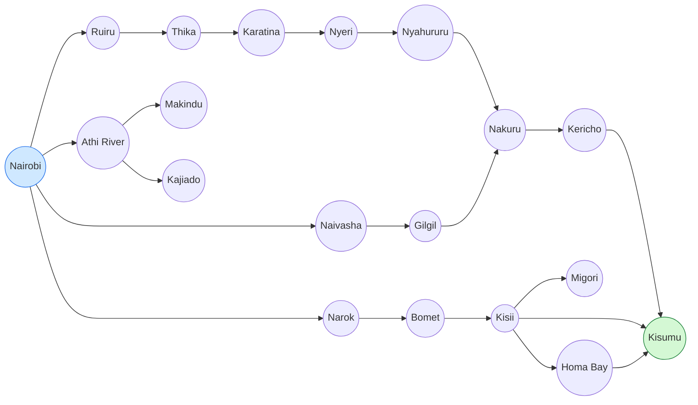
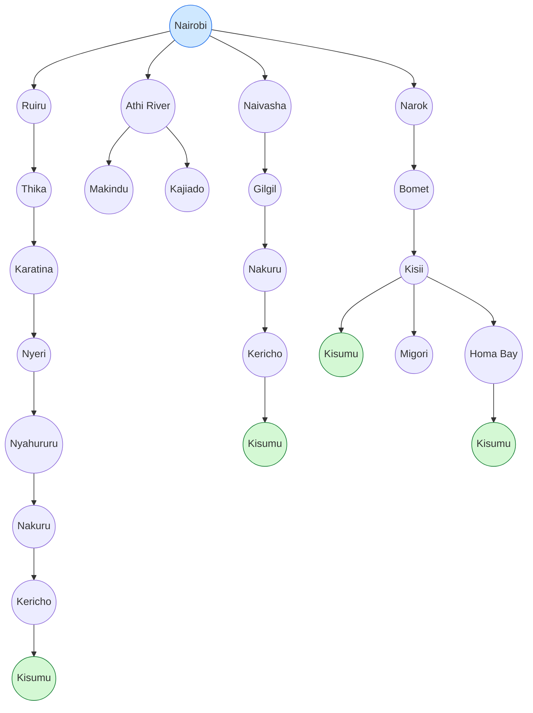
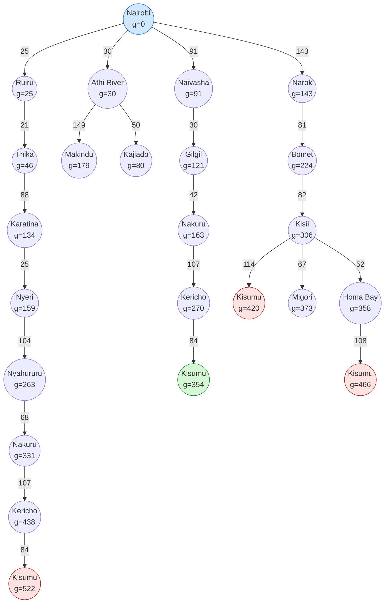
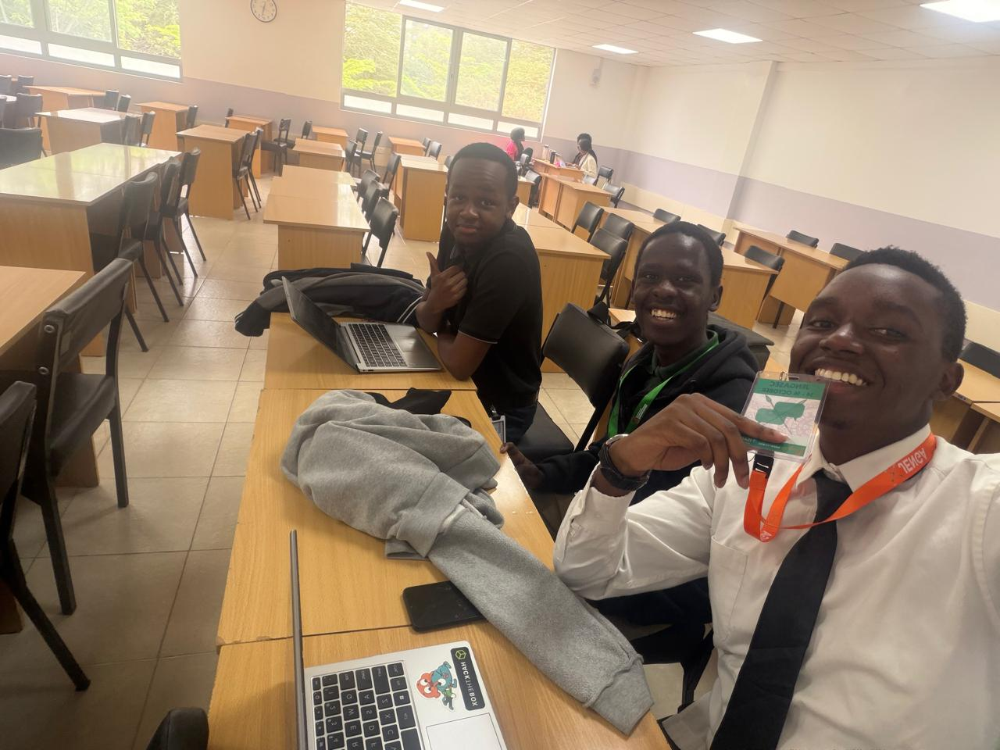

## Question 1: PEAS Framework and Agent Environment

**Agent:** A self driving trailer hauling cargo along Kenya's highway network, with the Nairobi to Kisumu run as our working example.

### Part A: PEAS description

| Component | Description |
|---|---|
| **Performance measure** | Getting the cargo there in one piece comes first. A crash or a pile of damaged goods would wipe out any gain from speed, so safety carries the most weight. After that we would look at distance and travel time, fuel use, whether the trailer keeps to traffic laws and speed limits, and whether it turns up on schedule. |
| **Environment** | Kenyan highways like the Nairobi, Nakuru and Kisumu corridor, and these roads are rarely tidy. Potholes, steep Rift Valley escarpments and sharp curves are common, and the weather can swing between rain, fog (around Limuru or Kericho, for instance) and dust. The road is shared with matatus, buses, other trucks and boda bodas, plus pedestrians and livestock that tend to cross without warning. Signage, weighbridges, traffic law and the towns and junctions along the way complete the setting. |
| **Actuators** | Steering, accelerator, brakes, gear shift, lights and indicators, horn and wipers. We would also include a communication unit that reports to a dispatcher, since it lets the trailer act on the people around it and not only on the road. |
| **Sensors** | Cameras for lanes, signs and obstacles, GPS for location, and radar or LiDAR for distance to nearby objects. A speedometer and odometer cover the basics, while a gyroscope and accelerometer pick up tilt and trailer sway on slopes. Fuel, tyre pressure and engine sensors monitor the vehicle itself, rain and light sensors help with conditions, and a microphone could catch sirens and horns. |

**A note on rationality.** The performance measure here is meant to reflect what we actually want from the trailer, not how we imagine it ought to behave. That is why cargo safety and legal compliance sit above speed. A rational trailer, in this sense, picks whichever action is expected to maximise that measure, given what it has perceived so far and what it already knows, such as the road map and traffic rules.

**Agent structure.** It probably fits best as a model based, goal based agent. Because it cannot see everything, it has to keep an internal picture of the road, and because it is heading somewhere specific (Kisumu), it also needs to work towards that goal and not just react to what is in front of it.

### Part B: The 5 definitions of agent environments

| Definition | Classification | Justification |
|---|---|---|
| **Fully or partially observable** | **Partially observable** | The sensors never give the trailer the full picture. It cannot see around an escarpment bend or past the matatu ahead of it, and in rain or fog the sensors themselves may become noisy. It has to make informed guesses about the world, much like the robot taxi driver we discussed in class. |
| **Deterministic or stochastic** | **Stochastic** | Plenty happens that the trailer does not control. A boda boda may cut in, an animal may wander onto the road, a tyre could burst, and the weather can turn. The next state is likely to depend on far more than the current state and the trailer's own action. |
| **Episodic or sequential** | **Sequential** | Choices carry over. Speed, route and overtaking decisions early in the trip appear to shape fuel, timing and safety later on, so no single decision stands alone on the way from Nairobi to Kisumu. The self driving car example from class falls in the same category. |
| **Static or dynamic** | **Dynamic** | The world does not pause while the trailer thinks. Traffic keeps moving, pedestrians step out and the weather shifts, so the agent has to check the environment before acting and not rely on an old snapshot. |
| **Single agent or multiagent** | **Multiagent** | The trailer is never alone out there. It shares the road with drivers of matatus, buses and trucks, boda boda riders and pedestrians, and probably with police and weighbridge officials too. Their actions affect the trailer, and the trailer's actions affect them. |

## Question 2: Directed Graph and Search Tree

**Abstraction:** A state is the town the trailer is in, and an action is driving along a highway to the next connected town. Minor towns and junctions between two listed towns, traffic, road works and weather are left out. Dead-end towns (Makindu, Kajiado, Migori) are kept because the agent cannot know in advance that they do not lead to Kisumu.

### Directed graph

### Search tree

In the tree, a town reached by a different route appears again as a separate node (Nakuru, Kericho and Kisumu repeat), because each node represents one path from Nairobi.

## Question 3: Optimal Path from Nairobi to Kisumu
 
**Path cost function:** The cost of driving from one town to the next connected town is the driving distance between them in kilometres, rounded to the nearest km, as given by Google Maps. The cost of a path is the sum of the costs of its edges, written g(n) for a node n in the search tree. The best path is the one with the lowest total.
 
### Part A: Distances between connected towns
 
Each row is one edge of the directed graph in Question 2, so there are 21 in total.
 
| # | From | To | Distance (km) |
|---|---|---|---|
| 1 | Nairobi | Ruiru | 25 |
| 2 | Nairobi | Athi River | 30 |
| 3 | Nairobi | Naivasha | 91 |
| 4 | Nairobi | Narok | 143 |
| 5 | Ruiru | Thika | 21 |
| 6 | Thika | Karatina | 88 |
| 7 | Karatina | Nyeri | 25 |
| 8 | Nyeri | Nyahururu | 104 |
| 9 | Nyahururu | Nakuru | 68 |
| 10 | Athi River | Makindu | 149 |
| 11 | Athi River | Kajiado | 50 |
| 12 | Naivasha | Gilgil | 30 |
| 13 | Gilgil | Nakuru | 42 |
| 14 | Nakuru | Kericho | 107 |
| 15 | Kericho | Kisumu | 84 |
| 16 | Narok | Bomet | 81 |
| 17 | Bomet | Kisii | 82 |
| 18 | Kisii | Kisumu | 114 |
| 19 | Kisii | Migori | 67 |
| 20 | Kisii | Homa Bay | 52 |
| 21 | Homa Bay | Kisumu | 108 |
 
### Part B: Search tree with path costs
 
The search tree from Question 2 is repeated below, now with the edge distances on the arrows and the cumulative cost g(n) inside each node.
 

 
Green marks the cheapest route to Kisumu and red marks the more expensive routes to it.
 
### Part C: Comparison of all routes to Kisumu
 
| Route | Path | Calculation | Total (km) |
|---|---|---|---|
| Central Highlands | Nairobi → Ruiru → Thika → Karatina → Nyeri → Nyahururu → Nakuru → Kericho → Kisumu | 25 + 21 + 88 + 25 + 104 + 68 + 107 + 84 | 522 |
| **Naivasha, Nakuru** | **Nairobi → Naivasha → Gilgil → Nakuru → Kericho → Kisumu** | **91 + 30 + 42 + 107 + 84** | **354** |
| Narok, Kisii | Nairobi → Narok → Bomet → Kisii → Kisumu | 143 + 81 + 82 + 114 | 420 |
| Narok, Kisii, Homa Bay | Nairobi → Narok → Bomet → Kisii → Homa Bay → Kisumu | 143 + 81 + 82 + 52 + 108 | 466 |
 
### Conclusion
 
**The optimal path is Nairobi → Naivasha → Gilgil → Nakuru → Kericho → Kisumu, with a total cost of 354 km.** The next best route, through Narok and Kisii, is 66 km longer. 

---

### Team Photo

