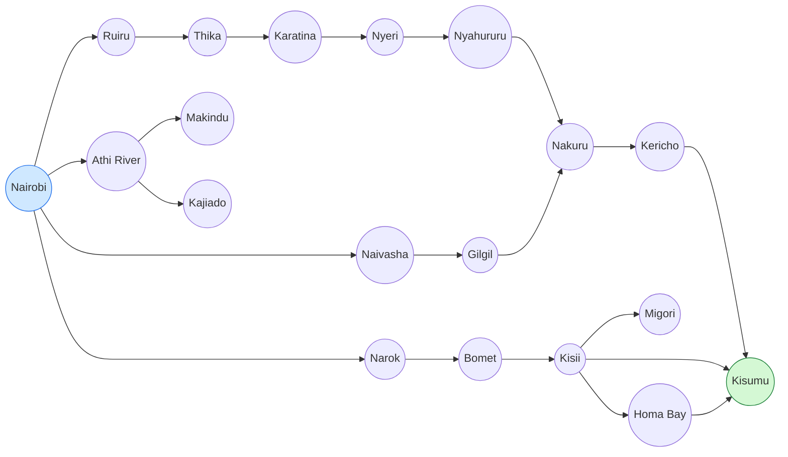
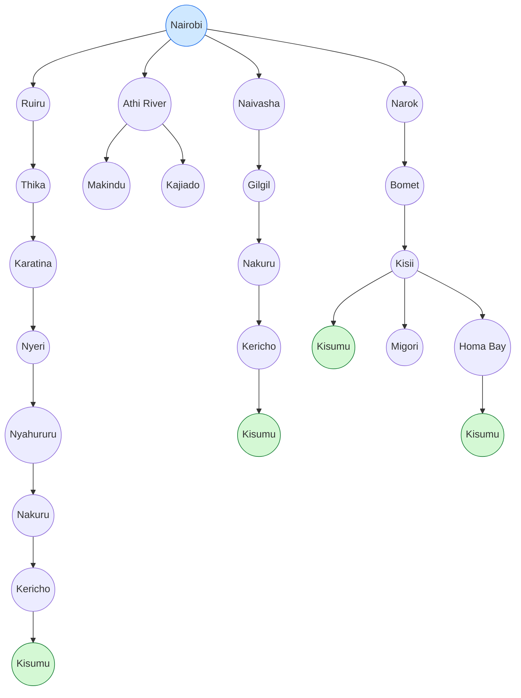

## Question 2: Directed Graph and Search Tree

**Abstraction:** A state is the town the trailer is in, and an action is driving along a highway to the next connected town. Minor towns and junctions between two listed towns, traffic, road works and weather are left out. Dead-end towns (Makindu, Kajiado, Migori) are kept because the agent cannot know in advance that they do not lead to Kisumu.

### Directed graph

### Search tree

In the tree, a town reached by a different route appears again as a separate node (Nakuru, Kericho and Kisumu repeat), because each node represents one path from Nairobi.